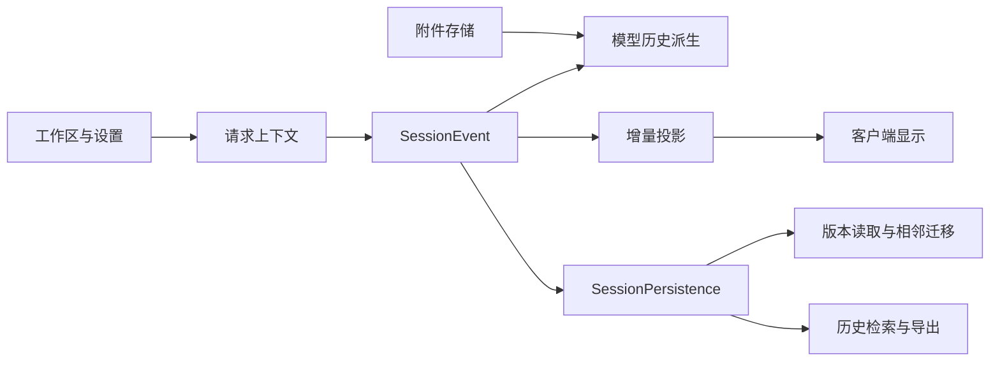

# 会话、存储与回放

## 概述

Session 是模型上下文和智能体行为的持久记录；其他存储各自承载工作区、设置、凭据和附件。不能把所有产品状态视为一份聊天消息数组。

## 目录

- [数据关系](#数据关系)
- [功能与责任](#功能与责任)
- [维护影响](#维护影响)

## 数据关系

## 功能与责任

| 主题 | 能力 | 所属说明 |
|---|---|---|
| 日志 | 追加事件、派生模型消息、fork 与恢复 | [Session](../../docs/subsystems/session.md) |
| 持久化 | JSONL 提供方、逻辑格式和物理保存 | [session](../capabilities/session.md) |
| 格式演进 | 当前格式读取、相邻版本迁移、保留已发布代次 | [格式状态](../../docs/session-format-status.md) |
| 投影 | 从已提交事件获得 Host 状态与 Client 视图 | [Session projection](../../packages/session/session-projection/README.md) |
| 搜索导出 | 过滤、全文搜索、关系追踪、有界读取与 ZIP 导出 | [session-query](../capabilities/session-query.md) |
| 二进制 | 附件身份与校验；过长文本结果另存并返回定位信息 | [attachment](../capabilities/attachment.md)、[spill](../capabilities/spill.md) |
| 产品状态 | 非会话存储、工作区、设置及凭据引用 | [storage](../capabilities/storage.md)、[workspace](../capabilities/workspace.md)、[settings](../capabilities/settings.md)、[credentials](../capabilities/credentials.md) |

## 维护影响

改变持久类型需遵守[类型变更确认流程](../../docs/cookbook/reviewing-persistence-type-changes.md)。会话恢复不等同于恢复所有进程资源，存储后端也不自动赋予外部工具重放副作用的能力。回放和 SDK 输出验证入口见[测试策略](../../docs/testing.md)。

## 开发备注

本页是源码导航与功能关系索引；精确字段、默认值和兼容性承诺由链接的所属文档维护。
