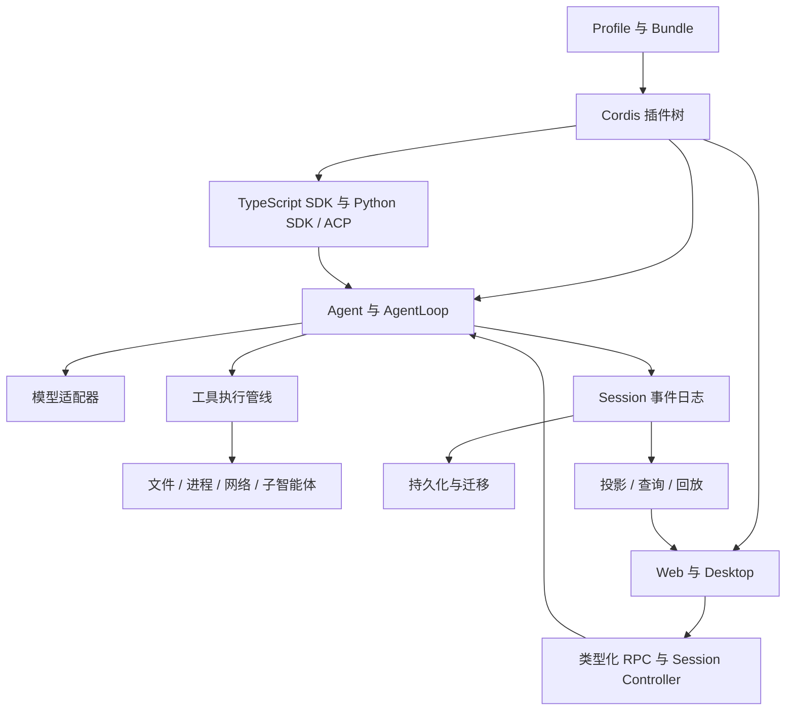

# 架构总图

## 概述

项目以 Cordis 插件组合应用，以持久 Session 事件记录智能体行为，以可替换的服务提供方承载执行能力。架构权威说明见[architecture.md](../../docs/architecture.md)。

## 目录

- [组成关系](#组成关系)
- [分层职责](#分层职责)
- [应用入口](#应用入口)
- [扩展影响](#扩展影响)

## 组成关系

图表示概念层的使用与数据流，不表示 SDK 直接调用同进程 Agent，也不表示某个 Profile 启用全部节点。

## 分层职责

| 层 | 职责 | 代码入口 |
|---|---|---|
| 组合与启动 | Profile、Bundle、补丁顺序、插件安装和配置 | [boot](../capabilities/boot.md)、[bundle](../capabilities/bundle.md)、[CLI](../../apps/cli/package.json) |
| 智能体运行 | 输入队列、轮次、步骤、模型请求、工具执行和取消 | [core](../capabilities/core.md) |
| 能力提供 | 服务定义、提供方和消费者；相互独立替换 | [能力服务关系](../../docs/capability-seams.md) |
| 数据 | Session 日志、投影、存储、历史检索及附件 | [数据流](data.md) |
| 交互 | Web、Desktop、SDK、ACP 与人类批准 | [交互功能](../features/interfaces.md) |
| 工程支持 | 类型图、运行时诊断、回放和质量检查 | [工程能力](../features/engineering.md) |

## 应用入口

支持的 Node 应用通过命名 `dsh` Profile 启动。Web、headless、SDK、sdk-minimal 与 ACP 的组合参见[启动架构](../../docs/architecture.md#application-launch)。Desktop 由 Electron 包装并使用保留 Profile；浏览器 WebWorker 预览属于实验实现。

[Python SDK](../../python/README.md)与[TypeScript SDK](../../packages/sdk/README.md)提供进程外集成；[原生模块](../../native/README.md)负责平台能力；[Cordis 副本](../../vendor/README.md)是插件框架来源。

## 扩展影响

新增能力先确定服务定义、提供方与消费者；工具再进入 `ctx.tools`。改变模型输入需检查持久事件与回放，改变 Session 类型需检查迁移和两个 SDK，改变 UI 需检查 Host 数据、Client 投影、本地化和真实流程证据。详细链路见[执行流程](execution.md)和[维护流程](../MAINTENANCE.md)。

## 开发备注

本页是源码导航与功能关系索引；精确字段、默认值和兼容性承诺由链接的所属文档维护。
